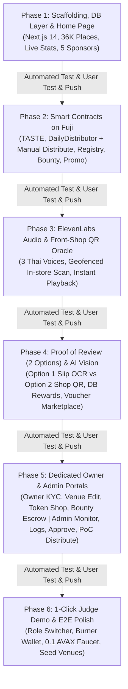

# TasteChain BKK — Implementation & Verification Plan (v3.2)

> **Repository:** [https://github.com/0xta/ProofofReview](https://github.com/0xta/ProofofReview)  
> **Target Network:** Avalanche C-Chain — Fuji Testnet (Chain ID: 43113)  
> **Database:** PostgreSQL 17 (`uhack-postgres:5432`, DB: `tastechain`)  
> **Changelog Tracker:** [`CHANGELOG.md`](./CHANGELOG.md)  
> **Product Requirements Document:** [`TastechainPRD.md`](./TastechainPRD.md)

---

## 1. Architecture & Phased Roadmap Overview



---

## 2. Standard 5-Step Execution Protocol for Every Phase

Every phase follows a strict 5-step lifecycle ensuring high software quality, user alignment, and continuous delivery:

```
┌────────────────────────────────────────────────────────────────────────┐
│                   PHASE EXECUTION & VERIFICATION CYCLE                 │
├────────────────────────────────────────────────────────────────────────┤
│  1. 🛠️ Implementation: พัฒนา Component, API, Smart Contract, Service   │
│  2. 🧪 Automated Test & Verify: รัน Automated Test Suite + Query Bench │
│  3. 🧑‍💻 User Interactive Checkpoint: ผู้ใช้เปิดทดลองเล่น & ปรับปรุงตามใจ │
│  4. 📝 Changelog Update: บันทึกรายการเปลี่ยนแปลงลง CHANGELOG.md        │
│  5. 🚀 Git Commit & Push: Commit (Conventional) และ Push ขึ้น GitHub   │
└────────────────────────────────────────────────────────────────────────┘
```

1. **Implementation:** Develop required components, routes, smart contracts, or backend services.
2. **Automated Test & Verify:** Execute automated test scripts, verify queries, inspect on-chain states, and measure response times.
3. **User Interactive Checkpoint (ให้ผู้ใช้ทดลองใช้งาน & ให้ Feedback):** 
   - จัดเตรียมคู่มือการทดสอบ (How to Test), URL หน้าจอ, คำสั่ง CLI, หรือข้อมูลตัวอย่าง
   - ให้ผู้ใช้ได้ทดลองคลิกเล่นจริง ทดสอบฟังก์ชัน และแจ้งปรับปรุงจุดเล็กๆ น้อยๆ ได้ทันที
   - เมื่อผู้ใช้ตรวจสอบและอนุมัติ (Approve) จึงค่อยดำเนินขั้นตอนถัดไป
4. **Changelog Documentation:** Record features added, files changed, and test results into [`CHANGELOG.md`](./CHANGELOG.md).
5. **GitHub Synchronization:** Commit changes using Conventional Commits and push to `origin main` ([https://github.com/0xta/ProofofReview](https://github.com/0xta/ProofofReview)).

---

## 3. Detailed Phase Breakdown

### Phase 1: Project Scaffolding, Database Service Layer & Home Page with 5 Sponsors

#### Objectives
- Initialize Next.js 14+ App Router project with TypeScript, Tailwind CSS, and DaisyUI (`dark` & `coffee` themes).
- Establish robust PostgreSQL connection pool connecting to `uhack-postgres:5432` (`tastechain`).
- Verify and migrate companion tables (`owner_verifications`, `place_owners`, `admin_activity_logs`, `shop_voices`, `in_store_qr_checkins`, `daily_token_epochs`, `user_epoch_shares`, `customer_claimable_rewards`, `merchant_token_bounties`, `merchant_promotions`).
- Implement Data Access Layer for 36,369+ Bangkok F&B venues (`places` table).
- Build Search & Filter API (`/api/places`) with pagination, category badges, rating filters, and coordinate bounding boxes.
- Implement **Home Page (`/`)**:
  - Hero section explaining the Trustless Gastronomy Protocol.
  - Interactive User Flows selector for **3 Roles: Customer, Owner, Admin**.
  - Live Platform Statistics (36,369+ F&B places, verified reviews count, total $TASTE emission, active bounties).
  - Prominent CTA Link to **Judge Guide & Interactive Tour (`/judge`)**.
  - **5 Platform Sponsors & Partners Section:**
    1. **U-Topia:** Web3 Entertainment, Gamification & Real-world Asset (RWA) Ecosystem
    2. **ElevenLabs:** Generative Voice AI สังเคราะห์เสียงต้อนรับและขอบคุณภาษาไทย 3 สไตล์ต่อร้าน
    3. **Avalanche C-Chain:** บล็อกเชนความเร็วสูง สำหรับ Smart Contracts, Escrow และ Micro-rewards
    4. **U-Bot:** Automated Web3 Trading & Social Community Intelligence Bot
    5. **Tokenomist:** ผู้ออกแบบกลไก Dynamic Tokenomics, 80/20 Burn และ Mining Emission
- Implement **Judge Guide & Interactive Command Center Page (`/judge`)**:
  - ศูนย์กลางคู่มือและสถานีทดลองฟังก์ชันสำหรับกรรมการ (Customer, Owner, Admin Sandbox)
  - เชื่อมโยงกับปุ่มใน Navbar และ Home Page

#### Deliverables
- `package.json`, `tsconfig.json`, `tailwind.config.ts`, `postcss.config.js`
- `src/lib/db.ts`: PostgreSQL connection pool with query timeout and error handling.
- `src/lib/services/places.ts`: Queries for Bangkok F&B places, pioneer slot status, and bounty flags.
- `src/app/api/places/route.ts`: API endpoint supporting `q`, `service_type`, `rating_min`, `has_bounty`, `limit`, and `offset`.
- `src/app/api/stats/route.ts`: Live platform statistics endpoint.
- `src/app/page.tsx`: Home Page with Hero, User Flows walkthrough, Live stats, /judge CTA, and 5 Sponsors.
- `src/app/judge/page.tsx`: Dedicated Judge Guide & Interactive Sandbox Page.
- `tests/phase1-places.test.ts`: Automated test suite for database queries, stats endpoint, and page rendering.

#### Automated Verification & Test Strategy
| Test Case | Description | Expected Result |
| :--- | :--- | :--- |
| **T1.1 DB Connection** | Test pg pool connection to `uhack-postgres` | Status 200, query returns `NOW()` |
| **T1.2 Place Count** | Verify Bangkok operational F&B count | Returns $\ge 36,000$ places |
| **T1.3 Search Latency** | Query `q=ผัดไท` with limit 20 | Latency $< 300\text{ms}$ |
| **T1.4 Live Stats & Sponsors** | Fetch `/api/stats` and render Home | Correct venue count, review count, and all 5 sponsor cards displayed |

#### User Interactive Checkpoint (ให้ผู้ใช้ทดลองใช้งาน)
1. สั่งรัน `npm run dev` เปิดที่ `http://localhost:3000`
2. **ทดลองหน้า Home Page:** ตรวจดู Hero, ตัวเลขสถิติสด 36K+ ร้าน, กดสลับแท็บ User Flows 3 Roles (`Customer`, `Owner`, `Admin`), และดูการแสดงผลของ 5 Sponsors
3. **ทดลองค้นหาร้าน:** ลองพิมพ์ค้นหา เช่น *"ผัดไท"*, *"cafe"*, *"ทองหล่อ"* ดูความเร็วและผลลัพธ์
4. **จุดปรับปรุง:** ผู้ใช้แจ้งปรับ UI/ข้อความตามที่ต้องการ ก่อนอนุมัติเพื่อ Push ขึ้น GitHub

#### Changelog & Git Action
```bash
# 1. Update CHANGELOG.md under [v0.1.0-phase1]
# 2. Git Commit & Push
git add .
git commit -m "feat(phase1): scaffold Next.js app, DB places service, Home page with 5 sponsors"
git push origin main
```

---

### Phase 2: Smart Contracts on Avalanche Fuji (with Manual PoC Distribute)

#### Objectives
- Setup Hardhat development environment with Solidity 0.8.24.
- Implement 5 core smart contracts:
  1. `TasteToken.sol`: ERC-20 utility token with authorized minters, burn mechanism, and token purchase swap support.
  2. `TasteDailyDistributor.sol`: Epoch distribution vault for daily 10,000 `$TASTE` pool, with `claimReward` (signed oracle voucher) AND `manualDistributeEpoch` (1-click batch distribute for Hackathon PoC demo).
  3. `TasteChainRegistry.sol`: Pioneer slot claims (1–3), `bytes32` slip hash deduplication, and daily quotas (3/place/day, 10/day).
  4. `TasteChainBounty.sol`: Merchant escrow supporting AVAX and `$TASTE` bounty rewards.
  5. `TastePromotionEscrow.sol`: Voucher redemption with 80% to merchant and 20% deflationary burn.
- Write full Hardhat unit tests with coverage $\ge 90\%$.
- Deploy contracts to Avalanche Fuji Testnet and export addresses to `.env.local` and `src/config/contracts.ts`.

#### Deliverables
- `contracts/TasteToken.sol`
- `contracts/TasteDailyDistributor.sol`
- `contracts/TasteChainRegistry.sol`
- `contracts/TasteChainBounty.sol`
- `contracts/TastePromotionEscrow.sol`
- `test/TasteContracts.test.ts`: Automated Hardhat test suite.
- `scripts/deploy-fuji.ts`: Deployment and verification script.
- Contract addresses exported to `.env.local` and `src/config/contracts.ts`.

#### Automated Verification & Test Strategy
| Test Case | Description | Expected Result |
| :--- | :--- | :--- |
| **T2.1 Token Mint/Burn** | Test minter access control and user burn | Only minter can mint; balances update accurately |
| **T2.2 Manual Distribute** | Execute `manualDistributeEpoch` from oracle | Multi-recipient batch mints succeed in 1 transaction |
| **T2.3 Pioneer Registry** | Record 4 reviews for the same venue | First 3 get pioneer slots 1, 2, 3; 4th gets slot 0 |
| **T2.4 Promotion 80/20** | Redeem 199 `$TASTE` voucher | 159.2 `$TASTE` to merchant, 39.8 `$TASTE` burned |
| **T2.5 Fuji Deployment** | Verify contracts on Snowtrace Fuji | All 5 contracts deployed, verified, and callable |

#### User Interactive Checkpoint (ให้ผู้ใช้ทดลองใช้งาน)
1. รัน `npx hardhat test` ดูผลการทดสอบสัญญาครบ 100%
2. ดู Contract Addresses ที่ Deploy ขึ้น Avalanche Fuji Testnet
3. เปิดดูสัญญาจริงบน [Snowtrace Testnet Explorer](https://testnet.snowtrace.io)
4. **จุดปรับปรุง:** ตรวจสอบ Parameter เช่น ค่า Daily Emission (10,000 $TASTE) และสัดส่วน Burn (80/20)

#### Changelog & Git Action
```bash
# 1. Update CHANGELOG.md under [v0.2.0-phase2]
# 2. Git Commit & Push
git add contracts/ test/ scripts/ src/config/contracts.ts
git commit -m "feat(phase2): implement and deploy 5 smart contracts on Avalanche Fuji"
git push origin main
```

---

### Phase 3: ElevenLabs AI Voice Studio & Front-Shop QR Oracle

#### Objectives
- Integrate **ElevenLabs API** (`eleven_multilingual_v2`) for generating 3 customized Thai greeting & thank-you voices per venue.
- Build Audio Caching & Streaming Service to store and serve synthesized MP3 files.
- Implement Front-Shop QR generation with dynamic HMAC/nonce and in-store QR camera scanner (`html5-qrcode`).
- Build instant In-Store Check-in Oracle (`/api/checkin/qr`) with GPS proximity validation ($\le 100\text{m}$).
- Trigger instant UI Push Notification Banner + Web Audio playback of randomly chosen voice (1 in 3).

#### Deliverables
- `src/lib/services/elevenlabs.ts`: ElevenLabs API client with voice synthesis and fallback.
- `src/app/api/merchant/voice/route.ts`: API to generate and store 3 shop voices in `shop_voices`.
- `src/app/api/checkin/qr/route.ts`: Oracle endpoint validating GPS, recording check-in, and returning audio URL.
- `src/components/QRScannerModal.tsx`: In-browser camera QR scanner.
- `src/components/AudioGreetingPlayer.tsx`: HTML5 / Web Audio player with toast notification.
- `tests/phase3-audio-qr.test.ts`: Automated test script for ElevenLabs API and QR check-in oracle.

#### Automated Verification & Test Strategy
| Test Case | Description | Expected Result |
| :--- | :--- | :--- |
| **T3.1 Voice Synthesis** | Generate 3 voices for sample venue | 3 records in `shop_voices`, valid MP3 URLs |
| **T3.2 Random Dispatch** | Trigger 10 check-ins | Responses randomly distribute across available voices |
| **T3.3 GPS Geofence** | Test check-in with distance 50m vs 250m | 50m succeeds; 250m rejected with error |
| **T3.4 Rate Limiting** | Submit 2 check-ins from same wallet in 5 min | Second check-in rejected (1 visit/wallet/24h) |

#### User Interactive Checkpoint (ให้ผู้ใช้ทดลองใช้งาน)
1. เปิดหน้าทดสอบร้านค้าจำลอง (เช่น ร้านในบรรทัดทอง)
2. คลิกปุ่ม **"▶️ ฟังเสียงทักทาย AI"** ทดลองฟังเสียงสังเคราะห์ภาษาไทยจริงของร้าน
3. เปิดกล้องทดลองสแกน QR Code จำลอง และดู Notification Banner แจ้งเตือน + เสียงเล่นอัตโนมัติ
4. **จุดปรับปรุง:** ปรับแต่งสำเนียงหรือข้อความสคริปต์เสียง AI และระยะ Geofence

#### Changelog & Git Action
```bash
# 1. Update CHANGELOG.md under [v0.3.0-phase3]
# 2. Git Commit & Push
git add src/lib/services/elevenlabs.ts src/app/api/checkin/ src/components/
git commit -m "feat(phase3): integrate ElevenLabs 3-voice engine and front-shop QR check-in"
git push origin main
```

---

### Phase 4: Proof of Review (2 Options), Persistent DB Rewards & Vouchers

#### Objectives
- Implement Customer Review submission modal supporting **2 distinct Proof Options**:
  - **Option 1 (Slip Proof):** GPS ($\le 100\text{m}$) + Food Photo (pHash) + PromptPay Receipt (OpenAI Vision `gpt-4o-mini`) + Rating (1-5) & Message.
  - **Option 2 (Shop QR Proof):** GPS ($\le 100\text{m}$) + Food Photo (pHash) + Scan Shop QR Code + Rating (1-5) & Message.
- OpenAI Vision OCR extraction for PromptPay receipts: `bank_name`, `amount_thb`, `transaction_date`, `transaction_time`, `transaction_ref_id`.
- Compute `SHA-256(transaction_ref_id)` for zero-replay verification.
- Perceptual hash (`pHash`) on food photos to prevent reused imagery.
- Enforce **Pioneer 2x Multiplier**: First 3 reviewers of each venue receive **2x activity points** toward the daily 10,000 `$TASTE` pool.
- **Customer Reward Persistence & Claim Engine:** บันทึกและสะสมรางวัลทั้งหมดลง Database (`customer_claimable_rewards` / `user_epoch_shares`) เพื่อให้ลูกค้าสามารถเข้ามาดูยอดสะสมและกดรับ (Claim) เข้ากระเป๋าได้เมื่อสะดวก
- **Customer Promotion Redemption:** ให้ลูกค้านำ `$TASTE` ไปแลก Voucher อาหารฟรี/ส่วนลด 15% จากร้านค้า (โอน 80% เข้าร้านค้า, Burn 20%)

#### Deliverables
- `src/lib/services/slip-ocr.ts`: OpenAI Vision OCR service with structured schema validation.
- `src/lib/services/phash.ts`: Perceptual hash calculation utility.
- `src/app/api/reviews/verify-review/route.ts`: Unified verification API supporting Option 1 (Slip) and Option 2 (Shop QR).
- `src/app/api/customer/claim-rewards/route.ts`: Endpoint for customer to claim accumulated rewards from DB whenever convenient.
- `src/components/ReviewSubmitModal.tsx`: Interactive modal with Option 1 / Option 2 tabs, camera uploader, and Web3 signing.
- `src/components/PromotionVoucherList.tsx`: Marketplace UI for customers to redeem shop promotions using $TASTE.
- `tests/phase4-proof-options.test.ts`: Automated test suite for Option 1, Option 2, DB reward persistence, and voucher redemption.

#### Automated Verification & Test Strategy
| Test Case | Description | Expected Result |
| :--- | :--- | :--- |
| **T4.1 Option 1 (Slip)** | Submit valid GPS + Food + PromptPay slip | OCR succeeds, points awarded based on bill amount |
| **T4.2 Option 2 (Shop QR)** | Submit valid GPS + Food + Scanned Shop QR | QR validated, 3 points awarded + ElevenLabs audio triggers |
| **T4.3 Anti-Replay** | Resubmit identical slip ref ID | Immediate rejection with `Slip already used` |
| **T4.4 DB Reward Storage** | Reviewer completes review / epoch settled | Reward credited to DB `customer_claimable_rewards` |
| **T4.5 Customer Claim** | Customer clicks Claim My Tokens | Reward minted/transferred, status updated to `is_claimed=true` |
| **T4.6 Promo Redemption** | Customer redeems 199 $TASTE voucher | 80% to merchant, 20% burned, OTP code issued |

#### User Interactive Checkpoint (ให้ผู้ใช้ทดลองใช้งาน)
1. เปิดหน้า `/place/[placeId]` กดปุ่ม **"✍️ เขียนรีวิว & ยืนยันสิทธิ์"**
2. **ทดสอบ Option 1:** อัปโหลดรูปอาหาร + สลิป PromptPay ตัวอย่าง ดูการสกัด OCR ยอดเงินและวันเวลา
3. **ทดสอบ Option 2:** อัปโหลดรูปอาหาร + เลือกสแกน Shop QR Code และฟังเสียงขอบคุณอัตโนมัติ
4. **ทดสอบ Claim Reward:** ตรวจดูยอดเหรียญสะสมในหน้า `/profile` หรือ `/mining` แล้วทดลองกดปุ่ม Claim
5. **ทดสอบ Redeem Voucher:** นำเหรียญไปกดแลกเกี๊ยวซ่า 199 $TASTE ดูการตัดยอดและ Burn 20%
6. **จุดปรับปรุง:** ปรับแต่ง Layout ของฟอร์มรีวิว, ปุ่มสลับ Option, หรือข้อความแจ้งเตือน

#### Changelog & Git Action
```bash
# 1. Update CHANGELOG.md under [v0.4.0-phase4]
# 2. Git Commit & Push
git add src/lib/services/slip-ocr.ts src/app/api/reviews/ src/components/
git commit -m "feat(phase4): build Proof of Review 2 options, DB reward claim and voucher marketplace"
git push origin main
```

---

### Phase 5: Dedicated Owner & Admin Portals

#### Objectives
- **Owner Portal (`/owner`):**
  - **Ownership KYC Submission (`/owner/verify`):** Upload business proof (DBD registration, ID card, storefront photo, utility bills).
  - **Venue Details Management (`/owner/venues`):** Edit opening hours, description, contacts (Phone, LINE, FB, IG), and photos.
  - **Proof-of-Review Shop QR Code (`/owner/qrcode`):** Generate, preview, and print customized shop QR signs with ElevenLabs voice integration.
  - **Token Shop (`/owner/token-shop`):** Purchase `$TASTE` platform tokens using Fuji AVAX.
  - **Bounty Campaign Setup (`/owner/bounty`):** Deposit `$TASTE` into escrow to reward verified reviewers.
  - **Promotion Event Creation (`/owner/promotions`):** Setup promotional vouchers accepting `$TASTE` tokens (free item or bill discount).
  - **ElevenLabs AI Voice Studio (`/owner/voices`):** Create and customize Thai greeting and thank-you voice scripts and audio synthesis (3 slots per shop).
- **Admin Portal (`/admin`):**
  - **Monitoring Dashboard (`/admin/monitoring`):** Real-time counters for venues, verified reviews, token emissions, active bounties, and active users.
  - **Audit Logs (`/admin/logs`):** Audit trail of OCR verifications, QR check-ins, smart contract transactions, and security alerts.
  - **Owner Verification Approvals (`/admin/owner-approvals`):** Queue of submitted owner claims with document preview, Approve and Reject actions.
  - **Manual Token Distribution (`/admin/distribute-token`):** 1-Click trigger to settle daily epoch and distribute `$TASTE` rewards to participants (for Hackathon PoC demo).

#### Deliverables
- `src/app/owner/page.tsx` & `src/app/owner/[...slug]/page.tsx`: Full Owner Portal suite (KYC, Venues, QR, Tokens, Bounties, Promotions, Voices).
- `src/app/admin/page.tsx` & `src/app/admin/[...slug]/page.tsx`: Full Admin Command Center suite (Monitoring, Logs, Approvals, Manual Distribute).
- `src/app/api/owner/verify/route.ts`: Submission and query endpoint for owner KYC.
- `src/app/api/owner/promotions/route.ts`: API to create and manage shop promotions.
- `src/app/api/owner/voices/route.ts`: API to manage ElevenLabs greeting and thank-you voice scripts.
- `src/app/api/admin/approve-owner/route.ts`: Admin approval/rejection endpoint.
- `src/app/api/admin/distribute-token/route.ts`: 1-Click manual token distribution endpoint.
- `tests/phase5-portals.test.ts`: Test suite for Owner KYC/promotions/voices and Admin approvals/manual distribution.

#### Automated Verification & Test Strategy
| Test Case | Description | Expected Result |
| :--- | :--- | :--- |
| **T5.1 Owner KYC Submission** | Submit venue claim with document | Record created in `owner_verifications` with status PENDING |
| **T5.2 Admin Approval** | Admin clicks Approve on claim | Status becomes APPROVED, owner record created in `place_owners` |
| **T5.3 Venue Edit & Voices** | Approved owner updates hours & creates greeting voice | Venue and `shop_voices` records updated successfully |
| **T5.4 Create Promotion** | Owner creates 199 $TASTE free dish promo | Promo added to `merchant_promotions` and appears on venue page |
| **T5.5 Token Purchase** | Owner swaps 0.05 AVAX for $TASTE | $TASTE balance increases in owner wallet |
| **T5.6 Manual Distribute PoC** | Admin clicks Manual Distribute | Smart contract mints rewards to active participants immediately |

#### User Interactive Checkpoint (ให้ผู้ใช้ทดลองใช้งาน)
1. **ทดสอบฝั่ง Owner:**
   - เข้า `/owner/verify` ลองกรอกแบบฟอร์มขอสิทธิ์เจ้าของร้านและอัปโหลดเอกสารจำลอง
   - เข้า `/owner/qrcode` ลองสร้างป้าย QR Code พิมพ์ออกมาทดสอบสแกน
   - เข้า `/owner/token-shop` ลองแลกเหรียญ $TASTE ด้วย Fuji AVAX
   - เข้า `/owner/bounty` ลองตั้งแคมเปญบาวน์ตี้ 50,000 $TASTE
2. **ทดสอบฝั่ง Admin:**
   - เข้า `/admin/monitoring` ตรวจสอบ Dashboard ตัวเลขและกราฟสถิติสด
   - เข้า `/admin/logs` ตรวจดูประวัติกิจกรรมล่าสุด
   - เข้า `/admin/owner-approvals` ลองกดอนุมัติ (Approve) คำร้องที่ส่งมาจากฝั่ง Owner
   - เข้า `/admin/distribute-token` ลองกดปุ่ม **"🚀 Distribute Daily Tokens (PoC)"** สั่งแจกเหรียญทันทีในคลิกเดียว
3. **จุดปรับปรุง:** ปรับช่องข้อมูลในฟอร์ม KYC, ปรับแต่งหน้า Dashboard และข้อความแจ้งเตือน

#### Changelog & Git Action
```bash
# 1. Update CHANGELOG.md under [v0.5.0-phase5]
# 2. Git Commit & Push
git add src/app/owner/ src/app/admin/ src/app/api/owner/ src/app/api/admin/
git commit -m "feat(phase5): build dedicated Owner & Admin portals, KYC verification and manual distributor"
git push origin main
```

---

### Phase 6: 1-Click Judge Experience, Role Switcher & E2E Polish

#### Objectives
- Build **Role Navigation Switcher** in Navbar: `[ 🍜 Customer ] [ 🏪 Owner ] [ 🛡️ Admin ]` for seamless evaluation.
- Build **1-Click Judge Demo Mode**:
  - Auto-generate in-memory Burner Wallet.
  - Faucet service auto-airdropping **0.1 Fuji AVAX** (ค่าแก๊ส) และ **10,000 $TASTE** (Platform Tokens) จากกระเป๋าสำรองส่วนกลาง
  - ให้กรรมการมีโทเค็นพร้อมทดลองสร้างแคมเปญ Bounty (ฝากเหรียญ), ซื้อโปรโมชั่น, หรือแลก Voucher อาหารฟรีได้ทันที
  - Quick launcher to test pre-configured venues (*Ban That Thong* & *Ari*).
  - Pre-filled sample PromptPay slip & sample Shop QR for instant testing.
- Polish DaisyUI Dark & Coffee theme visuals across all pages.
- Execute full end-to-end automated and manual user testing.

#### Deliverables
- `src/components/RoleSwitcher.tsx`: Navbar quick-switch between Customer, Owner, and Admin views.
- `src/app/api/judge/faucet/route.ts`: Faucet API delivering 0.1 AVAX + 10,000 $TASTE tokens in 1 request.
- `src/components/JudgeDemoButton.tsx`: 1-Click burner wallet setup with dual AVAX + TASTE balance preview.
- `src/data/seed-venues.ts`: Pre-seeded demo venues with active promotions, voices, and bounties.
- `tests/e2e-demo.test.ts`: Full end-to-end journey test.

#### Automated Verification & Test Strategy
| Test Case | Description | Expected Result |
| :--- | :--- | :--- |
| **T6.1 Judge Faucet** | Click Judge Demo button | Burner wallet created, receives 0.1 AVAX + 10,000 $TASTE in $< 3\text{s}$ |
| **T6.2 Role Switching** | Switch between Customer, Owner, and Admin | Screens transition seamlessly with role-appropriate permissions |
| **T6.3 Full Journey** | Customer Review $\rightarrow$ Admin Approve Owner $\rightarrow$ Admin Distribute Token | Complete lifecycle completes without errors |
| **T6.4 Mobile View** | View on mobile viewport | Zero horizontal overflow, responsive modals |

#### User Interactive Checkpoint (ให้ผู้ใช้ทดลองใช้งาน)
1. กดปุ่ม **"⚡ 1-Click Judge Demo"** ใน Navbar: ตรวจดูว่าสร้าง Burner Wallet และได้รับ **0.1 Fuji AVAX + 10,000 $TASTE** ทันทีในไม่กี่วินาที
2. **ทดลองสร้าง Event ในฐานะ Owner ด้วยเหรียญที่ได้:** นำ 10,000 $TASTE ไปทดลองตั้ง Bounty Event หรือสร้างโปรโมชั่นแลกอาหาร
3. **ทดลองแลก Voucher ในฐานะ Customer:** นำ 199 $TASTE ไปกดแลกอาหารฟรีเพื่อดูการ Burn เหรียญ 20%
4. สลับ Role ผ่าน Role Switcher: ตรวจดูว่าสลับไปมาระหว่าง Customer, Owner, และ Admin ได้อย่างราบรื่น
5. **จุดปรับปรุง:** ตรวจสอบความสวยงามของธีม สี และการแสดงผลบนจอมือถือ

#### Changelog & Git Action
```bash
# 1. Update CHANGELOG.md under [v1.0.0-final]
# 2. Git Commit & Push
git add src/app/api/judge/ src/components/JudgeDemoButton.tsx src/components/RoleSwitcher.tsx
git commit -m "feat(phase6): implement 1-click judge burner wallet, role switcher and final polish"
git push origin main
```

---

## 4. Phase Verification Matrix Summary

| Phase | Core Deliverable | Verification Metric | User Interactive Checkpoint | GitHub Tag / Commit |
| :---: | :--- | :--- | :--- | :--- |
| **P1** | Scaffolding, DB Layer & Home (5 Sponsors) | Query latency $< 300\text{ms}$, 36K+ places, live stats | ลองค้นหาร้าน, ดูตัวเลขสด และ 5 Sponsors | `v0.1.0-phase1` |
| **P2** | 5 Solidity Smart Contracts with Manual Distribute | 100% test pass, verified on Snowtrace | ตรวจดูสัญญาบน Snowtrace Testnet | `v0.2.0-phase2` |
| **P3** | ElevenLabs AI Voice & Front-Shop QR Oracle | 3 shop voices generated, GPS geofenced check-in | ลองฟังเสียง AI และสแกน QR หน้าร้าน | `v0.3.0-phase3` |
| **P4** | Proof of Review (2 Options) & DB Rewards | OpenAI Vision OCR + QR check, Pioneer 2x | ลองรีวิว 2 Options, เคลมเหรียญ, แลก Voucher | `v0.4.0-phase4` |
| **P5** | Dedicated Owner & Admin Portals | Owner KYC approved, 1-Click Manual Distribute | ยื่น KYC, ตั้งบาวน์ตี้, แอดมินกดแจกเหรียญ PoC | `v0.5.0-phase5` |
| **P6** | 1-Click Judge Mode, Role Switcher & E2E Polish | $< 3\text{s}$ burner setup + 0.1 AVAX drip, live demo | ทดสอบ Full Journey 1-Click สำหรับกรรมการ | `v1.0.0-final` |
