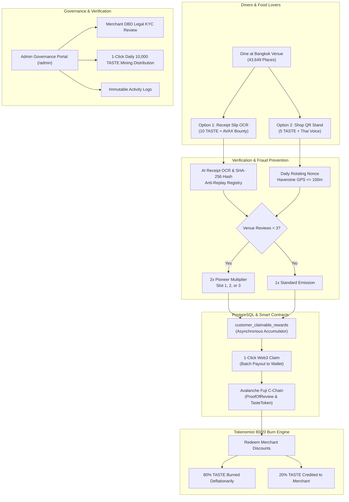

# 🍲 TasteChain BKK
### The AI-Powered & Trustless Gastronomy Protocol on Avalanche C-Chain

> **U-Hackathon @ Flow Summit Bangkok 2026** (24-Hour Hackathon)  
> **Network:** Avalanche C-Chain — Fuji Testnet (Chain ID: `43113` / `0xa869`)  
> **Repository:** [https://github.com/0xta/ProofofReview](https://github.com/0xta/ProofofReview)  
> **Local Demo URL:** `http://localhost:3002`

---

## 🌟 Executive Summary

Bangkok is the street food and culinary capital of the world, home to over 43,000 eateries. Yet today's gastronomy economy suffers from two systemic flaws:
1. **Fake & Sybil Reviews:** Unverified online reviews erode customer trust and harm authentic local vendors.
2. **Platform Extraction:** Web2 discovery platforms extract 25–35% gross commission margins from mom-and-pop vendors while giving zero ownership to food lovers and contributors.

**TasteChain BKK** solves this by establishing a decentralized, AI-verified, and cryptographically sound proof-of-dining protocol on Avalanche Fuji. Diners earn $TASTE tokens and native AVAX bounties for authentic dining verification, while merchants gain high-converting foot-traffic incentives without predatory middlemen.

---

## 🤝 5 Official Hackathon Sponsor Integrations

| Partner | Role & Exact Technical Integration |
|---|---|
| **U-Topia** | Decentralized physical infrastructure (DePIN) & Web3 AI layer for verifiable in-store dining experiences. |
| **ElevenLabs** | Multilingual Thai Voice AI studio with 3 tailored Bangkok personas (Warm & Welcoming, Energetic Casual, Luxury Chef) dynamically greeting diners at checkout and upon review submission. |
| **Avalanche C-Chain** | High-throughput, sub-second finality execution layer (Fuji Testnet `43113`) hosting 5 production-grade smart contracts, AVAX visit bounties, and immutable receipt slip hashes. |
| **u.bot** | Autonomous AI assistant used for generating TasteChain BKK branding/logos, conceptual slide graphics, and synthesizing the 10-minute hackathon pitch script and presentation content. |
| **Tokenomist** | Sustainable tokenomics advisory powering our **80/20 Deflationary Voucher Model**: 80% of $TASTE tokens redeemed for merchant vouchers are permanently burned from supply. |

---

## 📑 5-Phase Protocol Architecture



---

## 📜 Deployed Smart Contracts (Avalanche Fuji `43113`)

All contracts are deployed on Avalanche Fuji Testnet and verified with Hardhat test coverage:

| Contract | Purpose | Functionality |
|---|---|---|
| **`TasteToken`** (`$TASTE`) | ERC-20 Utility Token | Fixed daily emission target, burnable interface for 80/20 deflationary vouchers, minter-restricted issuance. |
| **`ProofOfReview`** | On-Chain Review Registry | Stores SHA-256 slip hash anti-replay, Pioneer slot assignment (slots 1–3), tier classification (Receipt vs QR). |
| **`MerchantEscrow`** | Native AVAX Visit Bounties | Merchants deposit AVAX; protocol relayer dispenses direct micro-bounties to verified diners upon check-in. |
| **`MerchantPromotions`** | 80/20 Deflationary Vouchers | Burns 80% of voucher $TASTE cost to reduce circulating supply; remits 20% to merchant. |
| **`DailyEpochRewards`** | Daily Mining Emission Pool | Manages 10,000 $TASTE daily distribution pool, 1-Click Admin PoC settlement, and asynchronous individual claims. |

---

## 🌐 Application Portals & Routing

| URL Route | Purpose | Key Features |
|---|---|---|
| **`/`** | Gastronomy Explorer | Browse & search 43,649 Bangkok venues, filter by street food/cafe/luxury, view real-time protocol statistics and live sponsors. |
| **`/customer`** | Diner Action Center | 2-Option Proof-of-Review submission, receipt slip sample loader, GPS simulator, Pioneer status tracker, 1-Click Web3 reward claim, voucher store. |
| **`/owner`** | Merchant Hub | ElevenLabs Thai Voice AI Studio (customize greetings across 3 personas), printable acrylic Counter QR Stand generator with daily nonce, KYC verification status. |
| **`/admin`** | Governance Console | Platform telemetry, Merchant DBD KYC verification queue (document modal preview, 1-click Approve/Reject), 1-Click 10,000 $TASTE Daily Epoch distribution, immutable audit logs. |
| **`/judge`** | 1-Click Hackathon Evaluation Hub | Comprehensive evaluator dashboard with 1-click test pipelines, contract architecture reference, and pre-seeded live Bangkok test data. |

---

## 🎨 3 Visual Themes (Navbar Top-Right)

TasteChain BKK provides 3 purpose-crafted visual themes toggled via the icon switcher at the **far right of the navigation bar**:
- ☀️ **White (`light`)**: Clean, crisp high-contrast aesthetic.
- 🥐 **Warm (`coffee`)**: Warm bakery, cafe, and artisanal gastronomy tone.
- 🌙 **Dark (`dark`)**: Cyberpunk obsidian evening dining ambiance.

---

## 🚀 Quickstart & Development

### Prerequisites
- Node.js 18+ & npm
- Docker (for PostgreSQL container)
- MetaMask browser extension (configured or auto-switched to Avalanche Fuji)

### 1. Start PostgreSQL Database
```bash
docker start uhack-postgres
```

### 2. Install Dependencies
```bash
npm install
```

### 3. Run Development Server
```bash
npm run dev -- -p 3002
```
Open [http://localhost:3002](http://localhost:3002) in your browser.

---

## 🧪 Comprehensive Test Suite (121 Passing Tests)

TasteChain BKK is thoroughly covered by unit, integration, and smart contract tests:

```bash
# 1. Smart Contracts Integration (Hardhat) - 12 tests
npm run test:contracts

# 2. Phase 1 Database & Bangkok Venues - 13 tests
npm run test:phase1

# 3. Phase 3 ElevenLabs Thai Voice & Shop QR - 19 tests
npm run test:phase3

# 4. Phase 4 Receipt Slip OCR, Anti-Replay & Claims - 26 tests
npm run test:phase4

# 5. Phase 5 Admin Governance, KYC & Epoch Mining - 23 tests
npm run test:phase5

# 6. Phase 6 Judge Faucet, Curated Venues & E2E - 28 tests
npm run test:phase6
```

**Total Test Coverage: 121 / 121 Passing Tests (0 Failed)**

---

## 🔮 Future Roadmap

1. **U-Topia Super-App Direct Payment Integration:**
   - Deeply connect with **U-Topia's all-in-one wallet and payment infrastructure**, allowing diners to directly spend accumulated $TASTE tokens and digital assets at counters of all 43,649 Bangkok partner eateries.
   - Utilize U-Topia's cross-chain liquidity rails so international tourists visiting Bangkok can settle street food and restaurant bills with any crypto asset, automatically triggering Tokenomist 80/20 deflationary burns.
2. **Avalanche Subnet / L1 Migration:** Launch a dedicated gas-free TasteChain Subnet sponsored by merchant promotion pools.
3. **LINE Mini-App Integration:** Embed seamless review and voucher redemption into Thailand's primary messaging super-app (54M users).
4. **POS & Cash Register Integration:** Partner with POS providers (Wongnai POS, Ocha) for automatic cryptographic receipt slip generation.
5. **Regional Expansion:** Expand to Chiang Mai, Phuket, Singapore, and Tokyo.

---

## 📄 License
MIT &copy; 2026 TasteChain BKK Team. Built with pride for U-Hackathon @ Flow Summit Bangkok 2026.
